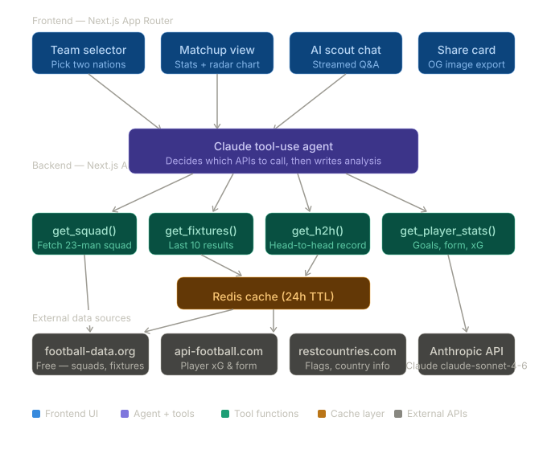
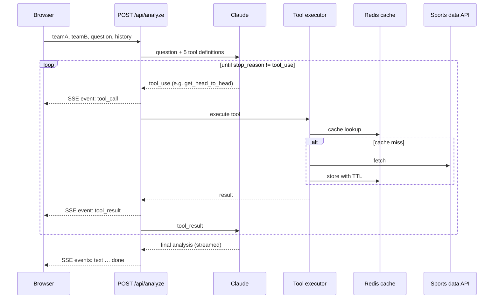

# Scout AI — World Cup 2026 Matchup Intelligence

[](https://github.com/nsrathore/world-cup-scout/actions/workflows/ci.yml)

> Pick any two of the 48 World Cup 2026 nations and get an AI scouting report built from live squad, form and head-to-head data — then keep asking follow-up questions.

**[Live demo →](https://world-cup-scout.nikkirathore.com)** &nbsp;·&nbsp; Next.js 16 · TypeScript · Claude API (tool use) · Upstash Redis · Vercel

---

## What it does

- **Matchup reports.** Choose two teams and Claude writes a scouting analysis covering form, squad depth, key players and historical edge.
- **Agentic data gathering.** Claude decides which data it needs and calls server-side tools to fetch it, instead of being handed a fixed prompt.
- **Follow-up chat.** Ask questions about the matchup; the conversation keeps its context and can trigger new tool calls.
- **Visual stats.** Radar charts compare team aggregates side by side.
- **Share cards.** Every matchup gets a generated 1200×630 Open Graph image at the edge.

## How the agent works



The request lifecycle in detail:



**Tools exposed to Claude:** `get_squad`, `get_recent_form`, `get_head_to_head`, `get_team_stats`, `get_player_stats`.

## Engineering notes

- **Streaming through Next.js.** Next.js patches `global.fetch` with a caching layer that buffers whole responses, which made the Anthropic SSE stream appear to hang. The agent passes undici's `fetch` to the SDK so tokens stream to the browser as they arrive.
- **Cache with per-data TTLs.** Squads cache for 24 h, fixtures 6 h, player stats 12 h and head-to-head 7 days, matching how often each changes. If Redis is unavailable the app falls back to direct API calls instead of failing.
- **Typed event protocol.** The stream emits `text`, `tool_call`, `tool_result`, `done` and `error` events, so the UI can show which data the agent is fetching in real time.
- **Abuse protection.** Per-IP rate limiting on the analysis endpoint and a 60-second function ceiling.

## Tech stack

| Layer | Technology |
|---|---|
| Framework | Next.js 16 (App Router), React 19, TypeScript |
| AI | Anthropic Claude API with tool use, Server-Sent Events |
| Data | Bzzoiro Sports Data API |
| Cache | Upstash Redis (REST) |
| UI | Tailwind CSS 4, Radix UI, Recharts, Framer Motion |
| Images | `@vercel/og` (edge runtime) |
| Hosting / CI | Vercel, GitHub Actions |

## Project structure

```
app/
├── api/analyze/        # Claude tool-use agent, streamed as SSE
├── api/{squad,fixtures,h2h,player-stats}/   # Data endpoints used by the UI
├── api/og/             # Edge-rendered share images
└── matchup/[teamA]/[teamB]/   # Matchup page
lib/
├── claude.ts           # Agent loop and streaming
├── tools.ts            # Tool definitions and executor
├── bsd-api.ts          # Sports data client
├── cache.ts            # Redis cache helpers and TTLs
└── teams-data.ts       # Static data for all 48 nations
```

## Running locally

```bash
git clone https://github.com/nsrathore/world-cup-scout
cd world-cup-scout
npm install
cp .env.local.example .env.local   # add your keys
npm run dev
```

| Variable | Required | Purpose |
|---|---|---|
| `ANTHROPIC_API_KEY` | Yes | Claude API ([console.anthropic.com](https://console.anthropic.com)) |
| `BSD_API_KEY` | For live data | Sports data API |
| `UPSTASH_REDIS_REST_URL`, `UPSTASH_REDIS_REST_TOKEN` | No | Enables caching |
| `NEXT_PUBLIC_APP_URL` | No | Absolute URLs for share images |

---

Built by [Nikhilendra Rathore](https://nikkirathore.com) · [LinkedIn](https://linkedin.com/in/nikhilendrasrathore)
